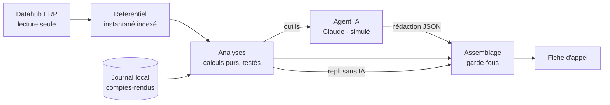

# Copilote télévente

Assistant pour les télévendeurs d'un distributeur alimentaire (frais et surgelé).
Il s'appuie sur les données de l'ERP, lues en **lecture seule** via le datahub, et aide le télévendeur à chaque étape de sa journée :

| Écran | À quoi il sert |
|---|---|
| **Appels du jour** | La liste des clients à appeler, triée par priorité. Chaque client a un score sur 100 et ses raisons : rappel promis, jour de commande habituel, retard, produits décrochés, lots à DLC courte, poids du client, tendance. |
| **Fiche d'appel** | Ce qu'il faut savoir avant de décrocher : habitudes, produits habituels non commandés, stock à écouler avec la remise suggérée, suggestions croisées et 2 ou 3 phrases d'accroche. Elle est rédigée par l'IA. |
| **Compte-rendu** | Après l'appel, le panier proposé ligne par ligne (accepté / refusé), l'issue et un rappel éventuel. Le copilote produit alors le **bon à saisir dans l'ERP**. |
| **Vue 360** | Le chiffre d'affaires mensuel, la répartition des achats, les produits récurrents et l'historique des appels d'un client. |
| **Stock** | Le plan d'écoulement : pour chaque lot à DLC courte ou en surstock, les clients à qui le proposer et la part du lot qu'ils pourraient absorber. |
| **Suivi** | Les taux d'acceptation par type de proposition, le CA généré, les appels transformés en commande et les résultats par télévendeur. |
| **Labo** | Pour l'équipe projet : ce que l'IA voit (prompt, outils et leurs schémas, résultats bruts) et la comparaison des rédacteurs côte à côte. |

> Toutes les données du dépôt sont **fictives** : 30 clients, 80 produits, 6 mois de commandes et des lots avec DLC, générés par un script avec une graine fixe.

## Démarrage rapide

Prérequis : Python 3.12 ou plus. Node.js n'est utile que pour modifier l'interface.

```bash
python -m venv .venv && source .venv/bin/activate
pip install -r requirements.txt
python -m scripts.peupler_journal_demo --vider   # facultatif : ~45 appels fictifs pour la démo
python -m copilote                                # http://localhost:8000
```

**Sans clé d'API, l'IA est simulée.** Le copilote rejoue des rédactions produites par Claude (voir plus bas), avec exactement le même protocole que l'IA réelle. Pour utiliser Claude :

```bash
export ANTHROPIC_API_KEY=sk-ant-...
python -m copilote
```

Les commandes courantes sont regroupées dans le `Makefile` (`make aide`).

## Comment l'IA est utilisée

**Les chiffres viennent du code, les mots viennent de l'IA.**



1. Les **analyses** font tous les calculs : rythmes d'achat, retards, rotation du stock, remises, pertinence et priorités. C'est du code déterministe et entièrement testé.
2. L'**agent** donne ces analyses à Claude sous forme d'outils (`historique_client`, `produits_habituels_manquants`, `stock_a_ecouler`, `suggestions_croisees`, `historique_appels`, `details_produit`). Claude les appelle, puis soumet sa rédaction via l'outil `soumettre_fiche`, dont le schéma JSON est strict.
3. L'**assemblage** construit la fiche finale et applique des **garde-fous**. Chaque correction est consignée et visible dans la fiche (« Corrections automatiques ») :
   - un produit cité par l'IA mais absent des analyses est écarté ;
   - une remise supérieure à la remise suggérée est ramenée à ce plafond ;
   - une offre (stock ou suggestion) refusée par le client dans les 14 derniers jours n'est pas reproposée ;
   - si ces corrections vident la sélection, elle est complétée à partir des analyses.
4. Les outils sont **verrouillés sur le client** de la fiche : l'IA ne peut pas lire les données d'un autre client.
5. La **trace** de chaque rédaction est conservée et affichée dans « Coulisses de l'IA » : appels au modèle, appels d'outils, durées et jetons.

### Trois rédacteurs interchangeables

Le mode se choisit avec `LLM_MODE`. La fiche indique toujours qui l'a rédigée.

| Mode | Rédacteur | Quand |
|---|---|---|
| `anthropic` | Claude (`claude-sonnet-5-5`) via le SDK officiel | Production, avec `ANTHROPIC_API_KEY` |
| `simule` | IA simulée : rejeu de conversations enregistrées | Démo et tests, sans clé ni réseau |
| `repli` | Gabarits, sans IA | Secours automatique si l'IA échoue (réseau, quota, refus, réponse invalide) |
| `auto` (par défaut) | `anthropic` si une clé est présente, sinon `simule` | — |

**L'IA simulée** (`copilote/agent/llm/cassettes/`) contient une conversation par client : appels d'outils successifs, éventuel approfondissement avec `details_produit`, puis rédaction. Ces 30 rédactions ont été **écrites par Claude** à partir des résultats réels des outils sur le jeu de données fictif.

Le fournisseur simulé suit le même protocole que l'API. Il exige notamment le résultat de chaque appel d'outil. Toute la chaîne (boucle, garde-fous, trace, interface) se démontre et se teste donc sans clé. La commande `python -m scripts.cassettes verifier`, exécutée aussi en CI, contrôle que chaque cassette reste cohérente avec les données : produits existants et remises dans les plafonds.

**L'adaptateur Claude** (`copilote/agent/llm/claude.py`) est configuré ainsi :
- effort `medium` ;
- outils en `strict: true` ;
- historique complet renvoyé à chaque tour (blocs de réflexion compris) ;
- bascule serveur en cas de refus (`fallbacks: "default"`), désactivable avec `ParametresClaude(bascule_refus=False)`.

Il est testé à travers le vrai SDK, avec un transport HTTP simulé : le corps des requêtes et la traduction des erreurs (429, 401, 5xx) sont vérifiés.

## Architecture

Le code est organisé en couches : chaque couche ne dépend que des couches au-dessus d'elle dans ce tableau. Le détail est dans [`docs/ARCHITECTURE.md`](docs/ARCHITECTURE.md).

| Paquet | Rôle |
|---|---|
| `copilote/domaine` | Objets métier immuables (client, produit, commande, lot) et erreurs |
| `copilote/datahub` | Interface `DataSource` en lecture seule, source simulée, client REST du vrai datahub et cache |
| `copilote/journal` | Comptes-rendus d'appels : modèles, stockage SQLite **local**, statistiques |
| `copilote/analyses` | Calculs métier purs sur un `Referentiel` (instantané indexé). Toutes les règles sont dans `regles.py`. |
| `copilote/fiche` | Modèle de la fiche, assemblage avec garde-fous, repli sans IA, panier proposé, rendu texte |
| `copilote/agent` | Outils exposés au LLM, boucle de rédaction, trace, fournisseurs (`llm/`) |
| `copilote/services` | Orchestration : fiches (choix du rédacteur, repli, cache), journal, pilotage |
| `copilote/application.py` | Assemblage des composants à partir de la configuration (seul endroit qui choisit les implémentations) |
| `copilote/api` | FastAPI : routeurs par domaine, traduction des erreurs, interface web |
| `frontend/` | Interface en TypeScript strict, sans framework ni bundler, compilée dans `copilote/api/static/js` |

**Typage fort de bout en bout.**
- Python est vérifié par `mypy --strict`, et tous les modèles sont des modèles pydantic immuables.
- Le frontend est en TypeScript strict (`noUncheckedIndexedAccess`, `exactOptionalPropertyTypes`…).
- Les types TypeScript de l'API sont **générés à partir du schéma OpenAPI** (`python -m scripts.generer_types_ts`). Un changement de modèle côté serveur casse donc la compilation du frontend au lieu de passer inaperçu. La CI vérifie que ces types sont à jour.

### Règles métier (`copilote/analyses/regles.py`)

| Règle | Valeur par défaut |
|---|---|
| Produit « habituel » | Présent dans au moins 30 % des commandes et commandé au moins 3 fois sur 6 mois |
| Produit « manquant » | Non commandé depuis plus de 1,5 fois son rythme habituel (minimum 7 jours). Au-delà de 3 fois ce rythme, il est « décroché » (probable concurrent). |
| DLC courte | Frais : 30 % de la durée de vie, entre 2 et 5 jours. Surgelé : 30 jours. Un lot qui expire le jour même est exclu. |
| Surstock | Plus de 14 jours de ventes en stock pour le frais, plus de 90 jours pour le surgelé (rotation calculée sur 4 semaines) |
| Remise suggérée | DLC courte frais : 30 % à J+1, 25 % à J+2, 20 % à J+3, 15 % au-delà. Surgelé : 15 à 20 %. Surstock : 10 à 15 %. **Plafond : 30 %.** |
| Tendance | CA moyen par semaine d'activité, 12 dernières semaines comparées aux 12 précédentes (les vacances ne faussent pas le calcul) |
| Mémoire des refus | Une offre refusée n'est pas reproposée pendant 14 jours |
| Priorité d'appel | Points cumulés, plafonnés à 100 : rappel promis 60, jour de commande 30, retard 20, décrochages, manquants, lots urgents, gros client, baisse d'activité |

## API

La documentation interactive est disponible sur `/docs`. Endpoints principaux :

| Méthode | Chemin | Description |
|---|---|---|
| GET | `/clients` | Clients (filtres `q`, `type`, `televendeur`) |
| GET | `/clients/{id}` | Vue 360 |
| GET | `/clients/{id}/fiche` | Fiche d'appel (`mode=anthropic\|simule\|repli`, `regenerer=true`). Version texte : `/fiche.txt`. |
| GET | `/clients/{id}/produits/{code}` | Détail d'un produit pour ce client |
| GET | `/appels/file` | File d'appels du jour (`televendeur`) |
| POST | `/comptes-rendus` | Enregistre un compte-rendu dans le journal **local** et renvoie le bon à saisir dans l'ERP |
| GET | `/comptes-rendus`, `/comptes-rendus/{id}/saisie-erp` | Historique et bon de saisie |
| GET | `/statistiques` | Indicateurs d'efficacité (`jours`) |
| GET | `/stock/plan-ecoulement` | Plan d'écoulement du stock |
| GET | `/labo/agent`, `/labo/clients/{id}/outils`, `/labo/clients/{id}/comparaison` | Inspection de l'agent |
| GET | `/sante` | Source de données, date, rédacteurs disponibles, télévendeurs |

## Configuration

| Variable | Défaut | Rôle |
|---|---|---|
| `DATASOURCE` | `mock` | `mock` (données simulées) ou `http` (vrai datahub) |
| `LLM_MODE` | `auto` | `auto`, `anthropic`, `simule` ou `repli` |
| `ANTHROPIC_API_KEY` | (vide) | Clé d'API Anthropic |
| `ANTHROPIC_MODEL` | `claude-sonnet-5-5` | Modèle Claude |
| `LLM_LATENCE_SIMULEE_MS` | `0` | Latence ajoutée à l'IA simulée (démo réaliste) |
| `JOURNAL_PATH` | `var/journal.sqlite3` | Journal local des comptes-rendus |
| `MOCK_DATA_PATH` | jeu fourni | Autre fichier de données simulées |
| `DATAHUB_URL`, `DATAHUB_TOKEN`, `DATAHUB_TIMEOUT` | (vides), 10 s | Accès au vrai datahub |
| `CACHE_SECONDES` | `300` | Durée de vie de l'instantané des données (et du cache du datahub) |

## Qualité

```bash
make verifier   # ruff, mypy --strict, 128 tests (97 % de couverture), cassettes, types TypeScript
make front      # régénère les types puis compile le frontend (nécessite Node.js)
```

La CI GitHub Actions (`.github/workflows/ci.yml`) exécute ces contrôles sur chaque pull request. Elle compile aussi le frontend et vérifie que le JavaScript versionné est à jour.

Les tests sont organisés par couche :

| Fichier | Ce qu'il couvre |
|---|---|
| `test_datahub.py` | Mock, client HTTP (requêtes GET uniquement), cache, configuration |
| `test_analyses.py` | Calculs métier sur des cas construits à la main |
| `test_journal.py` | Stockage SQLite et en mémoire, statistiques |
| `test_fiche.py` | Garde-fous, repli, panier |
| `test_agent.py` | Outils, boucle de rédaction, IA simulée, adaptateur Claude via le SDK |
| `test_services.py` | Choix du rédacteur, cache des fiches, journal |
| `test_api.py` | Endpoints, codes d'erreur, types TypeScript à jour |

## Brancher le vrai datahub

Le copilote ne dépend que de l'interface `DataSource` (`copilote/datahub/base.py`). Brancher le datahub, c'est **compléter `copilote/datahub/http.py`**, où chaque point à confirmer est marqué `TODO(datahub)`, puis passer `DATASOURCE=http`. Les analyses, l'agent, l'API et l'interface ne changent pas.

### 1. Ce que le datahub doit fournir (lecture seule)

| Méthode `DataSource` | Appel supposé | Données attendues |
|---|---|---|
| `get_clients()` | `GET /clients` | id, nom, type d'établissement, ville, contact, téléphone, télévendeur |
| `get_client(id)` | `GET /clients/{id}` | idem ; 404 si inconnu |
| `get_order_history(client_id, depuis)` | `GET /commandes?client_id=…&depuis=AAAA-MM-JJ` | commandes **avec leurs lignes** : produit, quantité, prix unitaire HT |
| `get_products()` | `GET /produits` | code, libellé, catégorie, famille (frais/surgelé), unité, prix HT, durée de vie |
| `get_stock()` | `GET /stock/lots` | lots disponibles : produit, quantité, DLC, date de réception, entrepôt |

### 2. Points à implémenter ou à valider

1. **Authentification** : le client envoie aujourd'hui `Authorization: Bearer $DATAHUB_TOKEN`. À adapter si le datahub utilise un autre schéma (en-tête dédié, certificat…).
2. **Chemins et paramètres** des cinq appels ci-dessus.
3. **Pagination** (`_get_liste`) : deux formats sont gérés, une liste JSON directe ou `{"items": [...], "next": url}`, avec un garde-fou de 1 000 pages.
4. **Correspondance des champs** (`_vers_client`, `_vers_produit`, `_vers_commande`, `_vers_lot`). Quelques choix sont à arbitrer :
   - date de commande ou date de livraison ;
   - prix tarif ou prix net client ;
   - DLC ou DDM ;
   - stock disponible uniquement, hors réservé et hors bloqué qualité.
5. **Lignes de commande** : si `/commandes` ne les renvoie pas, prévoir un appel par commande, ou mieux, un endpoint qui les inclut.
6. **Volumétrie** : en mode `http`, la source est automatiquement placée derrière `SourceEnCache` (`CACHE_SECONDES`). Toutes les analyses d'une même période travaillent sur un seul instantané chargé en mémoire. Si l'historique global sur 6 mois devient trop lourd, on pourra demander au datahub des agrégats déjà calculés.
7. **Tests** : `tests/test_datahub.py` montre comment valider la correspondance des champs sans réseau (`httpx.MockTransport`). Il est conseillé d'y ajouter un exemple de réponse anonymisé par endpoint.

```bash
export DATASOURCE=http DATAHUB_URL=https://datahub.mon-entreprise.local/api/v1 DATAHUB_TOKEN=...
python -m copilote
curl localhost:8000/sante   # "source_donnees": "http"
```

### Règle absolue : rien n'est jamais écrit dans l'ERP

- La seule interface d'accès à l'ERP (`DataSource`) ne contient que des lectures.
- `HttpDataSource._get` est l'unique point de sortie réseau. Des tests vérifient que seules des requêtes `GET` sont émises et qu'aucune méthode d'écriture n'existe.
- Les comptes-rendus d'appels sont stockés dans le **journal local du copilote** (SQLite). La commande acceptée est restituée sous forme de **bon à saisir** : c'est le télévendeur qui la saisit dans l'ERP, comme aujourd'hui.

## Données de démonstration

```bash
python -m scripts.generer_donnees_mock          # régénère le jeu fictif (identique à chaque fois)
python -m scripts.peupler_journal_demo --vider  # ~45 comptes-rendus fictifs, dont 2 rappels pour aujourd'hui
python -m scripts.cassettes apercu C005         # ce que les outils renvoient pour un client
```

La date de référence du jeu fictif est figée au **23/10/2026**, pour que la démo soit reproductible. Les comptes-rendus sont horodatés à cette même date.
